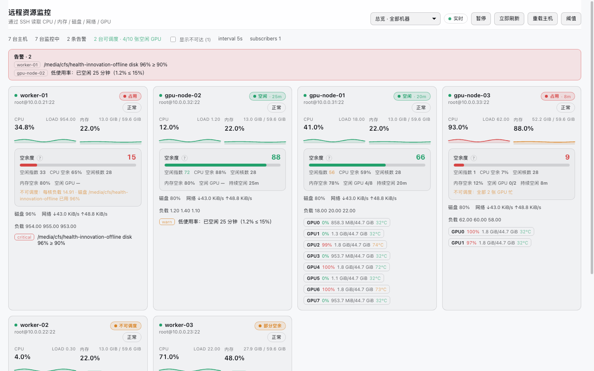
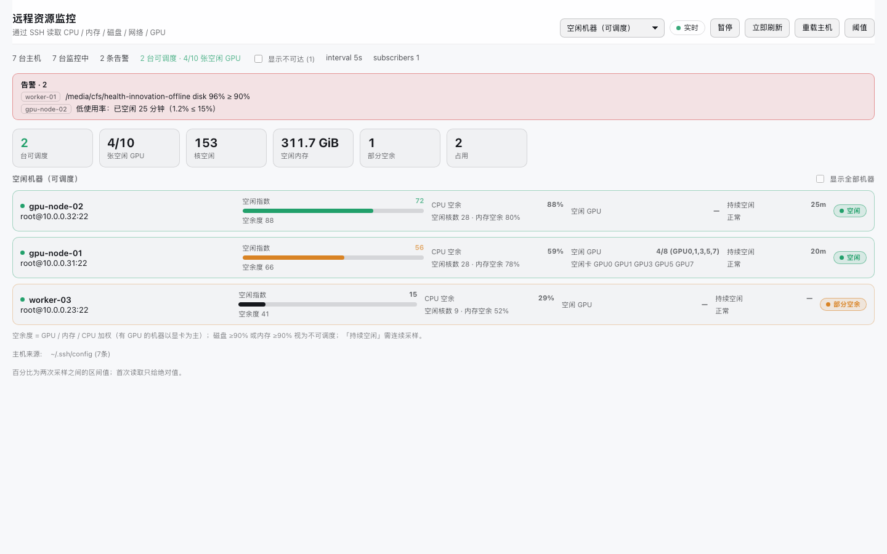
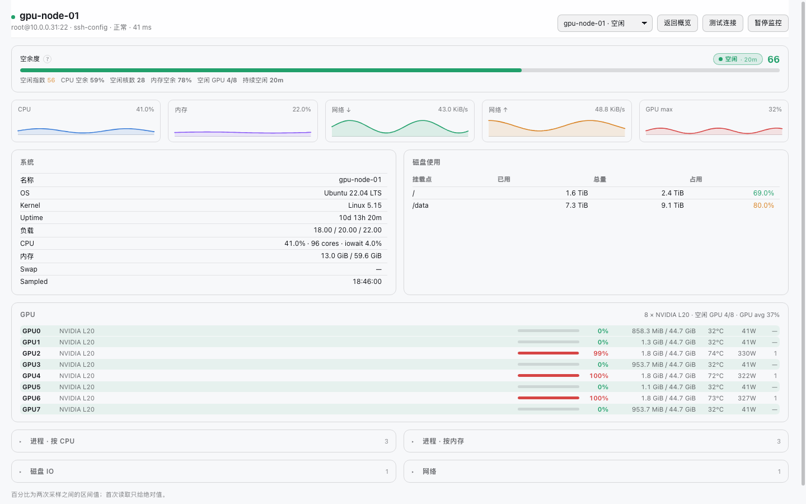
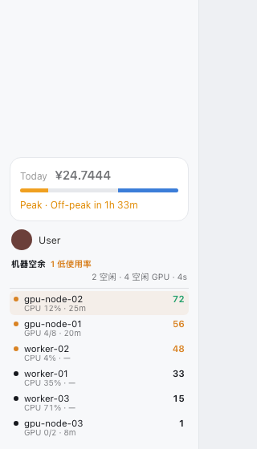
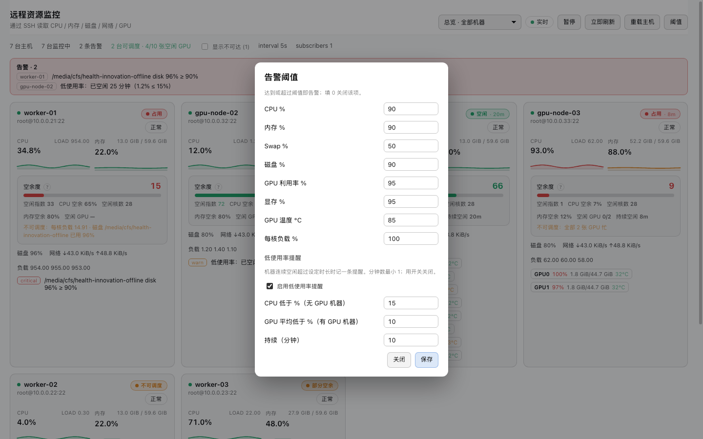
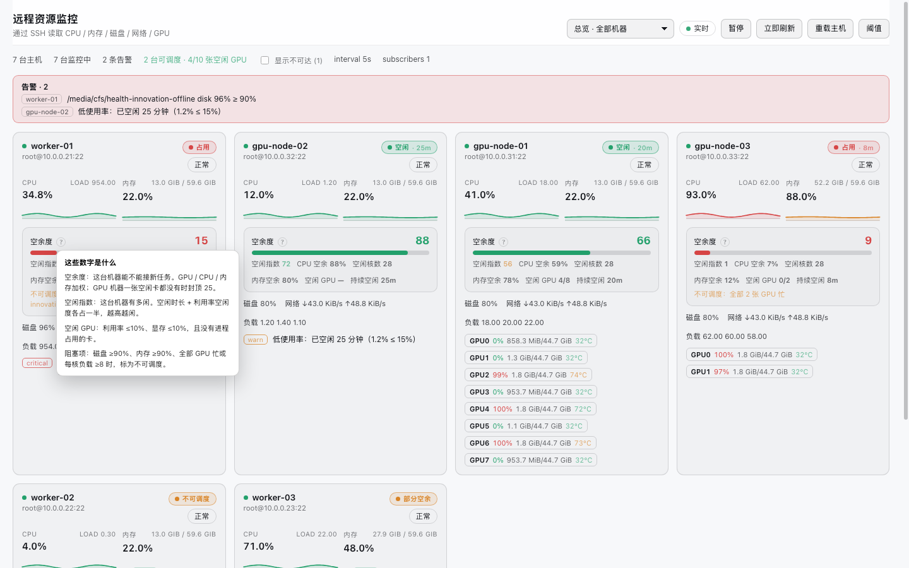

# dsh-remote-monitor — DSH 远程机器资源监控插件

在 DeepSeek Harness 的 Web GUI 侧边栏加一个「监控」页面，实时看远程机器的
**CPU / 内存 / Swap / 磁盘用量与 IO / 网络吞吐 / NVIDIA GPU / 进程 Top-N**，
同时给 agent 提供一组只读工具 `rmon_*`。

主机列表**不需要重新录一遍**：插件自动读取你已有的 `~/.ssh/config` 和 dsh-ssh
插件的主机配置。你配置过 SSH 的机器，装完就能看到。

## 效果图

截图使用演示数据（主机名、IP 均为示例），真实面板读取你自己的 `~/.ssh/config`。

| 总览 | 空闲机器（按空闲指数排序） |
| --- | --- |
|  |  |

### 单机详情：8 张 GPU 压到一屏

GPU 每卡一行，进程表 / 磁盘 IO / 网络默认折叠。



### 侧边栏机器列表

<p>
  
</p>

### 阈值与低使用率提醒 / 指标说明

| 阈值弹窗 | 指标说明 |
| --- | --- |
|  |  |

---

## 能力

| 能力 | 说明 |
| --- | --- |
| 主机发现 | 自动合并 `~/.ssh/config`（含 `Include`）、`$DSH_HOME/dsh-ssh.json`、以及插件自己的手工条目；同别名时后配置的覆盖前面的 |
| 认证链 | 依次尝试：条目指定的私钥 → ssh-agent → OpenSSH 默认私钥（顺序与 `ssh` 一致）→ 已保存的密码。**ssh-agent 为空时会跳过**，不做无用的连接 |
| 跳板机 | 支持 `ProxyCommand`（含 `%h` `%n` `%p` `%r` 占位符展开）与多级 `ProxyJump`；连接池按共享堡垒机分道，可切换为串行建链 |
| 连接复用 | 每台机器一条长连接，空闲 10 分钟回收；配置变更立即失效旧连接，绝不复用旧凭据建立的会话 |
| 指标 | CPU 使用率（区间值）+ 每核 + 负载 + iowait/steal、内存/Swap、各挂载点用量、磁盘 IO（读/写/繁忙度）、各网卡收发速率与累计流量、GPU（利用率/显存/温度/功耗/风扇/占用进程）、进程 Top-N（按 CPU 与内存） |
| 实时面板 | SSE 推送，SVG 手绘曲线（无图表依赖），主机卡片总览 + 单机详情（图表、磁盘表、IO 表、网卡表、GPU 卡片、进程表）；默认只列**可连接**的机器，不可达主机收在「显示不可达 (N)」开关后面 |
| 空余容量 | 每台机器一个 0..100 空余度 + 空闲 GPU 列表 + 空余核数/内存 + 持续空闲时长 + 阻塞原因（磁盘满/内存满/GPU 全忙/负载排队），直接回答「哪台能接新任务」 |
| 空闲指数 | 0..100 的单一排序指标：空闲时长（半衰期 30 分钟）+ 利用率空闲度（GPU 平均 / CPU）各占一半，空闲视图按它排序 |
| 指标解释 | 容量区标题旁的「?」弹出说明：空余度 / 空闲指数 / 空闲 GPU / 阻塞项分别是什么；每个指标也带悬停提示 |
| 紧凑详情 | 单机详情默认只展开「容量 / 曲线 / 系统 / 磁盘 / GPU」；GPU 每卡一行（行列化），进程表与磁盘 IO、网络默认折叠，8 卡机器一屏内看完 |
| 视图切换 | 顶部下拉条一个控件切到全部界面：总览、空闲机器、GPU 资源、告警中心，以及任意一台机器的详情；面板内容整体可滚动 |
| 侧边栏列表 | 侧边栏底部（成本卡同一区域）常驻一个机器列表：每行「名称 · 空闲指数 · GPU/CPU · 已闲时长」，按空闲指数排序，可滚动；侧边栏折叠时只留一个圆点+数字 |
| 告警 | 8 类阈值（CPU/内存/Swap/磁盘/GPU 利用率/显存/GPU 温度/每核负载），面板内可改，NaN 安全，填 0 关闭该项 |
| 低使用率提醒 | 机器连续空闲超过设定时长记一条 warn 告警（CPU 机器看 CPU%，GPU 机器看平均利用率），弹出在告警横幅、主机卡片、告警中心与 `rmon_alerts` 里；阈值弹窗内可开关、调阈值和时长 |
| Agent 工具 | `rmon_list` / `rmon_idle` / `rmon_status` / `rmon_gpu` / `rmon_processes` / `rmon_alerts` |
| 多语言 | 面板中英双语（跟随浏览器语言） |

---

## 设计要点

### 采集：一次往返，两个采样点

轮询是**按需**的：只有面板打开（有 SSE 订阅者）或 agent 最近调用过工具时才轮询，
空闲 60 秒后自动停止。装了插件但没人看的时候，不会一直挂着十条 SSH 连接和十个 `ps`。

每次轮询只发**一条** SSH 命令。CPU% / 网络速率 / 磁盘 IO 都是**与上一次采样的差值**，
所以数字描述的是采样区间，而不是在远端 `sleep` 出来的瞬时值。
一台机器**首次**被读取时（没有上一次采样）会自动补一次轻量探针（约 1 秒后再读一次
计数器），这样你第一眼看到的 CPU% 就是真实区间值，而不是 `null`。

### 探针为什么要 base64

远端脚本是**编译期常量**，不含任何调用方数据——别名、标签都不可能进入远端 shell。
脚本经 base64 传到远端执行，避免任何引号、`$`、反引号被远端登录 shell 重新解释。

### 磁盘用量为什么要去重

容器里 `df` 常常把根文件系统报两遍：一次是 `overlay /`，一次是 bind mount 的
`/dev/vda3 /etc/hosts`，字节数完全相同。只按文件系统名过滤会把 `overlay` 当伪文件
系统丢掉，结果一个容器只剩 `/etc/hosts` 这种行。所以：**保留 `overlay`**，并且只在
「数字完全一致 **且** 一个挂载点是另一个的祖先路径」时合并，保留更靠近根的那行——
两块真正独立的同容量磁盘不会被误合并。

### 空余度：哪台机器能接活

阈值回答「有没有出问题」，不回答「哪里有地方」。`src/capacity.js` 把一次采样折算成
调度视角的三个数：**空余度**（0..100）、**空闲 GPU**（例如 `3/4 · GPU0,GPU1,GPU3`）、
**空余核数与内存**，再叠加**阻塞原因**。

- 权重：有 GPU 的机器以显卡为主（GPU 0.5 / CPU 0.32 / 内存 0.18），纯 CPU 机器
  按 CPU 0.62 / 内存 0.38。缺哪项就把权重按剩余项重新归一化。
- 一张卡算「空闲」必须同时满足：利用率 ≤10%、显存 ≤10%、**且没有进程占着**。
  只按利用率会骗人——训练进程在等数据时利用率就是 0%，显存还握着 45 GB。
- 负载会扣 CPU 空余：`load/core` 每超 1 扣 20 分，`load/core ≥ 8` 直接判为阻塞、
  空余度封顶 15（`worker-01` 的 954/64 核就属于这种，CPU% 只有 35% 但根本不是空闲）。
- 有 GPU 但**一张都不可用**时，空余度封顶 25：显卡才是调度单位，CPU 再闲也没用。
- 阻塞项：磁盘挂载点 ≥90%、内存 ≥90%、全部 GPU 忙、`load/core ≥8`。阻塞只影响
  「可调度」标记，不篡改空余度——这样才能区分「闲但磁盘满了」和「真的忙」。
- **持续空闲**（`idleForSec`）只统计连续可调度的采样：磁盘满了不算、机器掉线清零。
  面板上的 `空闲 · 20m` 就是这个字段，首次采样为 0。

模型是纯函数，`test/capacity.test.js` 与 `test/monitor.test.js` 覆盖了权重、阻塞、
GPU 占用判定、以及采样器真的把 `capacity`/`idleForSec` 放进 payload。

### 空闲指数：闲了多久 × 闲了多少

「空余度」描述的是**余量**（还能放几个作业），「空闲指数」描述的是**闲置状态**，
回答的是「现在哪台机器最闲」。两个输入、各占一半：

```
utilIdle  = 100 - 利用率        // GPU 机器取各卡平均利用率，CPU 机器取 CPU%
timeScore = 100 * (1 - 2^(-idleSec / halfLife))   // 半衰期默认 30 分钟
index     = 0.5 * utilIdle + 0.5 * timeScore
```

所以：刚空出来的 0% 机器是 **50**，闲了 30 分钟是 **75**，闲 1 小时 **88**，闲 2 小时 **97**；
一台 GPU 平均 90% 的机器即使跑了一整夜也只有 **52** 上限附近，不会被当成空闲。
`idleSec` 来自采样器维护的「持续可调度」时钟，所以机器一掉线或磁盘写满就清零。

面板上：空闲视图的排序主指标、主机卡片与单机详情的 `空闲指数`、以及 `rmon_idle` 的 `idx` 列。

### 详情页为什么按「折叠」组织

一台 8 卡机器如果每张卡一张大卡、再摊开两张进程表，页面能拉到两三千像素。现在：

- **GPU 一行一张卡**：`GPU0  L20  [条] 100%  75.7/140.4 GiB  58°C  665W  2`，8 卡约 180 px；
  进程数放最后一列，悬停看 PID/名称/显存。
- **进程表默认折叠**：标题行显示条数（`进程 · 按 CPU 3`），需要时展开。
- **进程表列宽按比例固定**（PID 8% / 名称 15% / CPU 10% / 内存 9% / RSS 12% / 命令 46%），
  命令行单行省略，不再把面板撑宽；点击某一行在行下方展开完整命令（等宽字体、自动换行、
  最高 180 px 滚动），不再用原生 `title` 弹一个盖住整张表的大 tooltip。
- **磁盘 IO / 网络**同样折叠；「系统 / 磁盘用量 / 曲线 / 容量」保持常驻。
- 表格里的命令行统一截断，不再撑破面板。

### 为什么默认隐藏不可达机器

不可达主机对「哪里有容量」这个问题没有信息量，还会把可用的机器挤出首屏。面板默认
过滤掉 `status === 'down'` 的条目；统计行保留 `显示不可达 (N)` 开关，展开后它们回到
列表里（样式仍是红色边框），方便排查。下拉视图选择器也只列可连接的机器。

### 侧边栏列表：一眼看完谁空着

侧边栏底部不再是「点开才看到列表」，而是直接铺开：

```
机器空余            1 低使用率    2 空闲 · 3 空闲 GPU
● beijing-L20      72   CPU 12% · 25m
● gpu-node-01      56   GPU 3/4 · 20m
● cfs-worker       48   CPU 4% · —
...
```

- 只列**可连接**的主机（`status === 'ok'`），按空闲指数从高到低；低使用率机器整行带琥珀底。
- 行高两行：主行是名称和指数，次行是 GPU 空闲卡数（无 GPU 的机器显示 CPU%）与已闲时长。
- 列表区自己滚动（最大约 210 px），不会把侧边栏其他内容顶掉。
- 侧边栏折叠时退化为「圆点 + 数字」：数字是有低使用率告警时的告警台数，否则是空闲台数。

### 侧边栏列表：实时流 + 兜底轮询

列表以前是 60 秒轮询，看起来“不动”。现在：

- **标签页可见时订阅与面板同一条 SSE 流**，列表随 5 秒采样一起更新；标题栏右侧显示
  `· 3s`（最近一次采样距今多久），数字不变时也能看出它在刷新，而不是卡住了。
- **60 秒的 `/hosts` 轮询保留为兜底**：负责主机清单/设置变更，并在 SSE 断流时
  （`/snapshot?fresh=1`）主动拉一次数据。SSE 活着时不会重复采样。
- 标签页隐藏时关闭 SSE、停止请求；`footer.live=false` 可以退回“只轮询”的省资源模式。
- 折叠侧边栏时靠 `ResizeObserver` 切到「圆点 + 数字」，不猜 shell 的类名。

代价要说清楚：列表常驻在页面上，所以 GUI 打开期间采样器会按 5 秒节奏持续工作
（与面板开着时一致）。不想付这个成本就把 `footer.live` 关掉，回到 60 秒一次。

### 低使用率提醒：闲到值得说一声

阈值告警是「用得太狠」，低使用率提醒是「一直没人用」。它复用了空余模型的时钟，
但判定独立：

- **CPU 机器**：CPU% ≤ `cpuBelow`（默认 15%）**且** `load/core < 1.5`。后一条很重要——
  一台 6% CPU 但 `load/core` 3.0 的机器是在等 IO，不是空闲。
- **GPU 机器**：所有卡的平均利用率 ≤ `gpuBelow`（默认 10%）**且没有卡被占用**。
  「被占用」指显存 ≥20% 或有计算进程——推理服务 0% 利用率但握着 40 GB 显存，
  提醒它「空闲」是错的。
- 持续时间单独计时（`lowSince`），达到 `forSec`（默认 600 s）才写告警；
  和「可调度」无关：磁盘满的机器照样可以「闲得浪费」，掉线则清零。
- 告警级别固定 `warn`，`key: 'low-usage'`；面板按字段本地化，工具里是英文一行。

### CPU 明细的单位

`/proc/stat` 里 `user/system/iowait/steal` 都是**累计 jiffies**。直接透传会得到
`iowait 355544059%` 这种数字。现在它们和 CPU% 一样，是**区间占比**。

---

## 安全模型

- **只读**。这组工具**没有任何执行任意命令的入口**：远端唯一会执行的文本就是
  `probe.js` 里那段固定脚本。需要执行命令请用 dsh-ssh 的 `ssh_exec`。
  这也是它敢让 agent 无人值守地轮询一整个集群的原因。
- 所有 `/api/dsh-remote-monitor/*` 路由**仅限回环**（socket 地址 + Host 头 + 同源
  标记三重校验，不信任 `X-Forwarded-For`）。这些接口会拿着你的凭据去读远程机器。
- **不校验 known_hosts**。中间人能看到的是资源计数器，本插件不传输凭据和载荷。
  这一点是明确取舍，不是疏忽。
- 密码/私钥口令**不落本插件**：插件只写 `$DSH_HOME/dsh-remote-monitor.json`
  （0600），里面只有监控开关、显示名、手工主机定义和阈值。凭据留在你原本放的地方
  （ssh-agent、私钥文件，或 dsh-ssh 的 `dsh-ssh.json`）。
- `ProxyCommand` 是**本机**以 DSH 宿主进程权限执行的命令——与 `ssh(1)` 对同一行的
  信任完全一致。它只能来自你自己 0600 的配置文件，agent 无法写。

---

## 配置

插件设置页（Config schema）与面板里的「阈值」按钮都可以改，**面板改的写入 JSON
文件并覆盖 Config 默认值**。

| 字段 | 默认 | 说明 |
| --- | --- | --- |
| `enabled` | `true` | 总开关（路由、工具、提示词段落） |
| `announceToAgent` | `true` | 是否向 agent 声明本插件 |
| `intervalMs` | `5000` | 轮询间隔，限制 2000..600000 |
| `concurrency` | `4` | 并发轮询的主机数 |
| `historyLimit` | `240` | 每台机器保留的历史点数（曲线用） |
| `topN` | `8` | 探针返回的进程条数 |
| `timeoutMs` | `30000` | 单条远端命令预算 |
| `connectTimeoutMs` | `15000` | 单次建连预算 |
| `serializeBastion` | `false` | 同一堡垒机是否串行建链（见下） |
| `alwaysOn` | `false` | 无人查看时也持续轮询（可积累连续历史） |
| `idleStopMs` | `60000` | 空闲多久后停止轮询 |
| `cacheTtlMs` | `2000` | agent 读取时复用采样的新鲜度窗口 |
| `rateProbeDelayMs` | `1000` | 冷启动两次探针之间的间隔 |
| `includeLoopbackNet` | `false` | 网络表是否包含 `lo` |
| `netInterfaces` | `''` | 网卡白名单（逗号分隔），空=全部 |
| `diskDevices` | `''` | 块设备白名单（逗号分隔），空=全部物理设备 |
| `thresholds.*` | 见上表 | 告警阈值，0 关闭该项 |
| `capacity.cpuFreeMin` | `60` | 剩余 CPU 百分比达到多少才算有空余 |
| `capacity.memFreeMin` | `50` | 剩余内存百分比 |
| `capacity.gpuUtilMax` / `gpuMemMax` | `10` / `10` | 一张卡算「空闲」的利用率/显存上限 |
| `capacity.gpuBusyUtil` / `gpuBusyMem` | `85` / `80` | 一张卡算「忙」的下限 |
| `capacity.freeScore` / `partialScore` | `60` / `30` | 空余度分段：空闲 / 部分空余 |
| `capacity.blockDiskPercent` / `blockMemPercent` | `90` / `90` | 达到即「不可调度」 |
| `capacity.blockLoadPerCore` | `8` | 每核负载达到即「不可调度」 |
| `lowUsage.enabled` | `true` | 低使用率提醒总开关 |
| `lowUsage.cpuBelow` | `15` | CPU 机器低于该利用率算「低使用」 |
| `lowUsage.gpuBelow` | `10` | GPU 机器平均利用率低于该值算「低使用」 |
| `lowUsage.forSec` | `600` | 持续多久才提醒（最小 60 秒） |
| `idleIndex.halfLifeSec` | `1800` | 时长分量的半衰期：闲了这么久得 50 分 |
| `idleIndex.utilWeight` / `timeWeight` | `0.5` / `0.5` | 利用率与时长两分量的权重 |
| `footer.enabled` | `true` | 侧边栏列表开关 |
| `footer.live` | `true` | 可见时订阅 SSE 实时更新；关闭则只走 60 秒轮询 |
| `footer.pollSec` | `60` | 兜底轮询间隔（最小 30 秒）；只在标签页可见时生效 |

### 关于 `serializeBastion`

默认 **false（并发）**，这是实测结论：三台可达机器共用一个 `wsCli` 网关，
并发建链 6.0 s 全部成功，串行 17.0 s。最初以为并发会打爆堡垒机，后来发现那次
失败的 `gpu-node` 用系统 `ssh` 也连不上——**它本来就是死机器**。
如果你的网关确实只允许单会话，把它打开。

---

## Agent 工具

| 工具 | 用途 |
| --- | --- |
| `rmon_list` | 列出被监控的机器及各自最新的 CPU/内存/GPU/磁盘摘要与可达性，含 `idle` 空余列 |
| `rmon_idle` | 按空余容量排序：哪台能接新任务、几张卡空着、空余几核/多少内存、空闲多久、被什么卡住；`idx` 列给出空闲指数 |
| `rmon_status` | 读取一台或全部机器的完整资源报告（可含进程表） |
| `rmon_gpu` | GPU 详情：利用率、显存、温度、功耗、占用进程 |
| `rmon_processes` | 按 CPU 或内存列出最忙的进程（PID/名称/CPU%/内存%/RSS/命令行） |
| `rmon_alerts` | 告警记录（阈值上限 + 低使用率提醒）与当前生效的阈值/提醒参数 |

百分比是区间值；首次读取只给绝对值并在报告里说明。
无人使用时轮询自动停止，agent 调用工具会立刻重新拉起。

---

## 安装

### 直接从 GitHub 安装

```sh
dsh plugin --profile desktop add github:digitrax1/dsh-remote-monitor
# 需要锁定版本时：github:digitrax1/dsh-remote-monitor#v0.8.1
```

装完重启 DSH 宿主进程。下面的手工方式在离线或改源码时使用。

### 手工安装

```sh
# 1) 让 profile 能解析到这个包（软链或复制皆可）
ln -s /path/to/dsh-remote-monitor \
      "$DSH_HOME/profiles/<profile>/node_modules/dsh-remote-monitor"

# 2) 在 profile 的 cordis.patch.yml 里加一行
#    - id: remote-monitor
#      name: 'dsh-remote-monitor'

# 3) 重启 DSH 宿主进程（或按 dsh 的插件重载方式），刷新 Web GUI
```

若使用插件管理器，等价于 `dsh plugin --profile <name> add link:<path-to-this-package>`。

`ssh2` 是本插件唯一运行时依赖；安装在 profile 里时它会从 profile 的
`node_modules`（hoisted）解析。

---

## 排错

| 现象 | 原因与处理 |
| --- | --- |
| 面板是空的 | 主机会被自动发现，但**首次读取**要等一个轮询周期；也可以点「立即刷新」。若列表本身为空，检查 `~/.ssh/config` 是否有 `Host` 块（含通配符的块会被跳过） |
| 某台机器一直「不可达」 | 用系统 `ssh <alias>` 对照验证。本插件报的是真实状态——例如 `No route to host` 就是真连不上 |
| 一台机器拖慢整轮 | 失败主机会指数退避（15s→30s→60s→120s），并且手动刷新与 agent 调用不受退避限制 |
| 首次刷新比较慢 | 走堡垒机的机器每条连接要 ~6 s 建链；连接池建立后复用，后续轮询是毫秒级 |
| 容器里磁盘行不对 | 已处理 overlay 根 + bind mount 去重；如仍不对，请附上远端 `df -P -k` 原样输出 |
| nvidia-smi 无输出 | 该机器没有 NVIDIA 显卡或没装驱动，面板会明确显示「未检测到 NVIDIA 显卡」 |

---

## 目录结构

```
src/probe.js       远端脚本 + 输出解析 + 速率推导（纯函数，可单测）
src/ssh-config.js  ~/.ssh/config 读取（Include 展开、Match 丢弃）
src/store.js       主机簿：三源合并 + 本插件设置持久化
src/pool.js        ssh2 连接池：认证链、ProxyCommand 占位符、ProxyJump、超时、退避
src/capacity.js    空余容量模型：空余度、空闲 GPU、阻塞项、持续空闲（纯函数）
src/monitor.js     采样器：按需轮询、历史环形缓冲、告警、失败退避、空余度快照
src/routes.js      /api/dsh-remote-monitor/* 与 SSE
src/tools.js       rmon_* agent 工具与文本渲染
src/loopback.js    回环 + 同源信任围栏
src/mount-once.js  单实例挂载守卫
src/index.js       宿主半入口（Config schema + apply）
src/client.js      浏览器半（自包含 module-loader 包）
```

## 测试

```sh
node --test "test/*.test.js"
```

- `test/probe.test.js` — 解析与推导，fixture 取自真实机器输出（含容器 overlay/bind
  mount、GNU df 长设备名换行、nvidia-smi 的 `[N/A]`、计数器回绕）
- `test/hosts.test.js` — ssh_config 解析、三源合并优先级、阈值/低使用率优先级与持久化、损坏配置降级
- `test/capacity.test.js` — 空余度权重、GPU 占用/阻塞判定、机队汇总、排序、低使用率判定、空闲指数公式
- `test/monitor.test.js` — 采样器端到端：payload 带 `capacity` 与 `idleForSec`，
  磁盘满/GPU 全忙/掉线的判定，空闲计时只累计可调度采样，低使用率持续到时限后产出告警，
  空闲指数随空闲时长增长
- `test/client.test.js` — 浏览器半的模块契约（模块 id、导出、三个 seat：侧边栏行、主页面、底部小条；失败降级）；
  以及一个**真实 DOM 挂载**测试，用真 React + jsdom 驱动实时数据、SSE 推送与详情页。
  该用例需要 `react`/`react-dom`/`jsdom`（见 devDependencies），缺失时自动跳过。

## 许可

Apache-2.0
